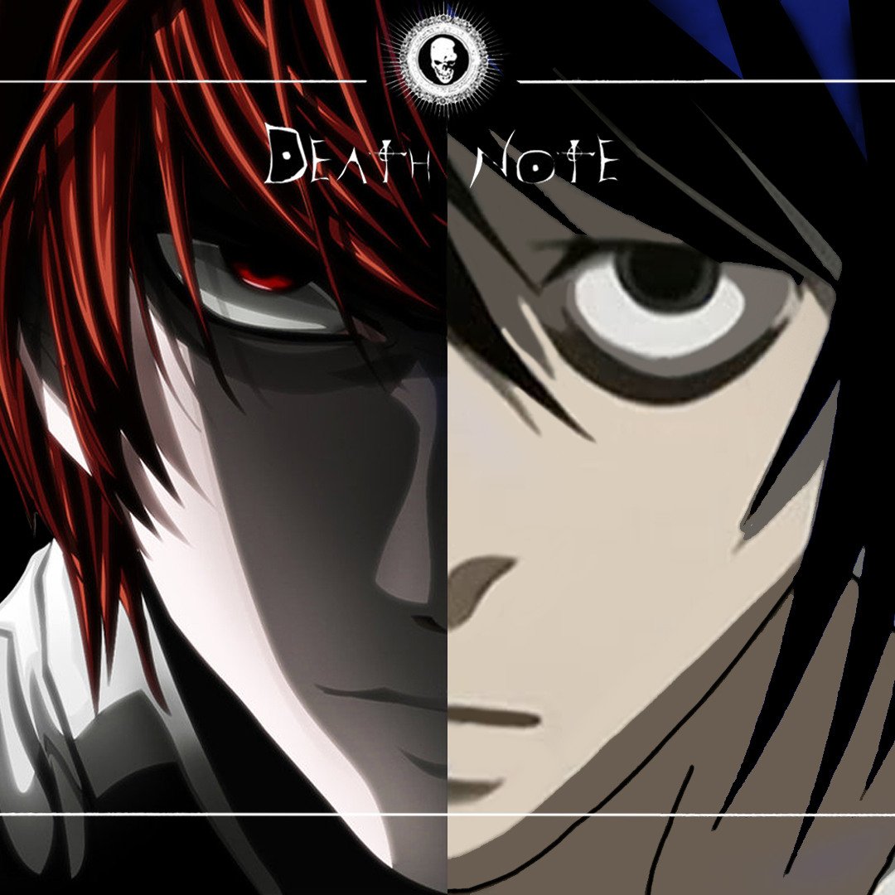
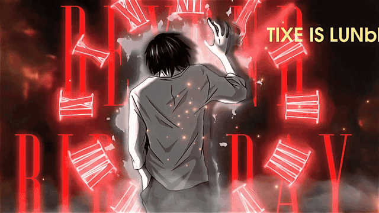

<!-- DEATH NOTE BANNER -->

  

<h1 align="center">Gabriel Camacho</h1>

<h3 align="center">Junior Frontend Developer</h3>

  
  

---

## 👨🏻‍💻 About Me

- 🎓 Higher Technician in Multiplatform Application Development (DAM).
- 💻 Interested in Frontend Development and Web Technologies.
- 🌱 Currently improving my skills in React and Tailwind CSS.
- 🤝 Interested in collaborative projects and teamwork.
- 🎯 Focused on building responsive and user-friendly web applications.

## 🛠️ Languages and Tools

### Frontend Development

  
  
  
  
  

### Tools & Design

  
  
  
  

---

## 🚀 Featured Projects

### 1. About Brennan Savage

Personal web project. Designed and developed the complete website, including its code and implementation.

### 2. Raíz Culinaria

Collaborative restaurant website developed with HTML, CSS and JavaScript.

- Developed the website's code.
- Coordinated the team's workflow and assigned tasks through GitHub Issues.
- Organized tasks related to content research, images, brand identity and Figma wireframes.
- Collaborated with the team throughout the development process.

### 3. Nightmare Club 🎬

🚧 Currently in development

Collaborative movie club project built with React and Tailwind CSS.

My responsibilities include:

- Developing the Home and Contact pages.
- Organizing and modularizing React components and project files.
- Contributing to the project's frontend architecture.

---

## 📊 GitHub Stats

  
  

---

## 📫 Connect with Me

  
  

---

<!-- DEATH NOTE GIF (FOOTER) -->

  

